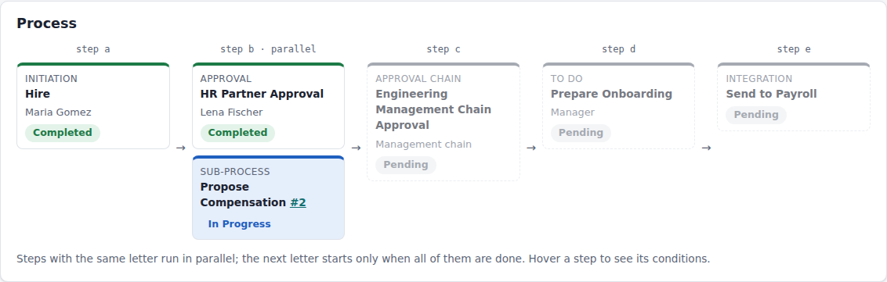
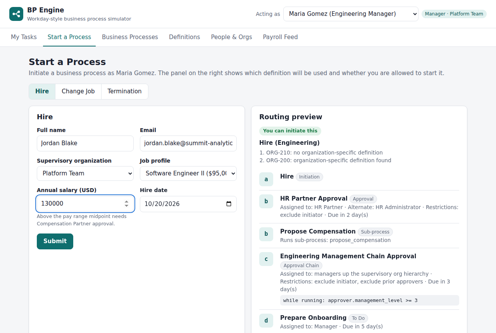
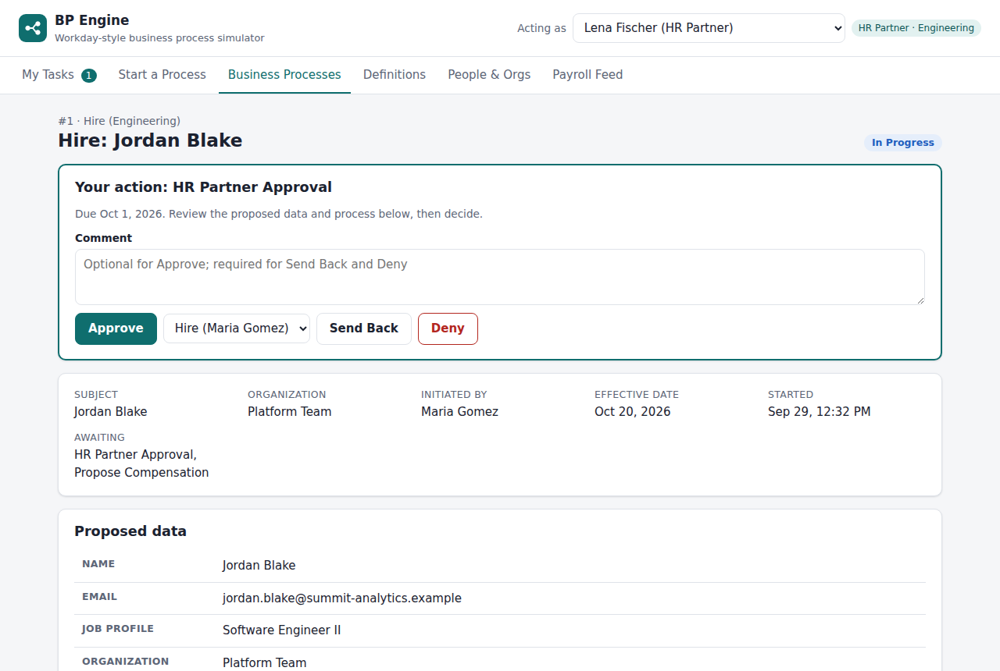
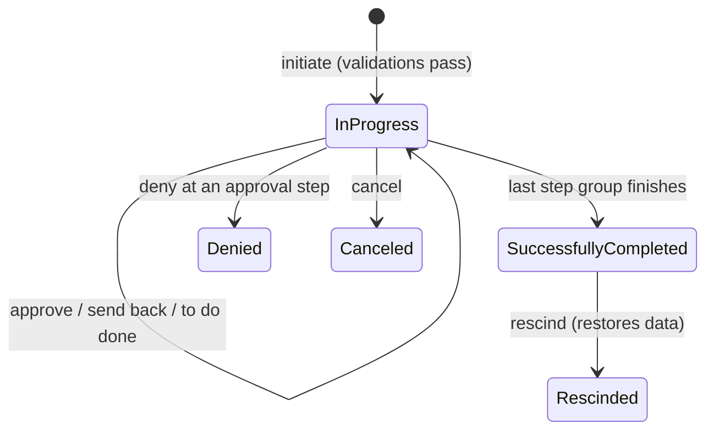

# Workday-Style Business Process Engine

A working simulation of how Workday routes HR transactions such as **Hire**, **Change Job** and **Termination** through approvals. It is built with **Python, FastAPI and SQLAlchemy** as a learning project. You can switch between 13 fictional employees, start business processes, approve, deny, send back, cancel and rescind them, and watch the engine route each step based on org structure, security roles and condition rules.

> Learning project. Not affiliated with, endorsed by, or based on the source code of Workday, Inc. It models publicly documented *concepts*; the implementation is original, and it simplifies things in places (see [Simplifications](#simplifications-vs-real-workday)).



| Start a process with a live routing preview | Approve, send back or deny |
| --- | --- |
|  |  |

---

## What this project demonstrates

| Workday concept | Where it lives here |
| --- | --- |
| **Business process types** with one **security policy** per type (who may initiate, cancel, rescind) | `definitions/security_policies.yaml`, `BP_TYPES` in `app/engine/engine.py` |
| **Default vs organization-specific definitions**. The lookup checks the event's org, then each superior org, then falls back to the default | `definitions/hire_engineering.yaml`, `DefinitionRegistry.resolve()` |
| **Step order letters** sorted alphabetically (`a, b, ba, c`). **Steps with the same letter run in parallel**, and the next letter waits for all of them | `order:` in the YAML, `BPEngine._advance()` |
| **Step types**: Initiation, Approval, Approval Chain, To Do, Integration, and a sub-process step (Workday starts sub-processes from Action steps) | `StepDefinition` in `app/engine/definitions.py` |
| **Condition rules**: entry conditions (skip a step), validation conditions (critical vs warning), while-running conditions on approval chains | `app/engine/conditions.py` (a safe, sandboxed expression evaluator) |
| **Routing restrictions**: exclude initiator, exclude prior approvers, exclude event subject, plus alternate routing | `BPEngine._route()` and `_excluded()` |
| **Role-based security groups** (Manager, HR Partner, Compensation Partner) assigned on **supervisory organizations** and inherited downward; **user-based groups** (HR Administrator, Business Process Administrator) | `app/engine/routing.py` |
| **Approval step** behavior: any one group member completes the step unless "all must approve" is set | `BPEngine.approve()` |
| **Actions**: Approve, Deny, Send Back (including from a sub-process to its parent's Initiation), Cancel (in progress only), Rescind (completed only, restores data) | `BPEngine` public methods |
| **Statuses**: In Progress, Successfully Completed, Denied, Canceled, Rescinded | constants at the top of `engine.py` |
| **Integration step** sending effective-dated changes to a (simulated) third-party payroll system | `BPEngine._run_integration()`, Payroll Feed page |

Engineering practices you can point to in an interview:

- **Declarative workflows**: routing lives in YAML validated by Pydantic, so a bad definition fails at startup, not mid-approval.
- **Sandboxed rules**: conditions are parsed with Python's `ast` module against a whitelist. There is no `eval`, no function calls and no dunder access, and tests prove that injection attempts are rejected.
- **Optimistic concurrency**: every action bumps a version number on the top-level business process, so two people acting on it at the same moment (even on different parallel steps) cannot both commit on stale data. The second request gets HTTP 409 and can simply retry.
- **Auditability**: a full process history, before/after snapshots of every data change, and definition snapshots taken at initiation (including sub-process definitions), so editing YAML never re-routes events that are already running.
- **86 automated tests** covering routing, security, every action and the edge cases, including regression tests for issues found in an independent review (run on Python 3.11, 3.12 and 3.13).

---

## Quick start

Requires Python 3.11 or newer.

```bash
python -m venv .venv
source .venv/bin/activate          # Windows: .venv\Scripts\activate
pip install -r requirements.txt
python -m app
```

Open **http://127.0.0.1:8000**. Interactive API docs are at **http://127.0.0.1:8000/docs**.

The app creates `bp_engine.db` (SQLite) on first run and fills it with demo data. To start over, act as Daniel Kim or Sofia Martins and click **Reset demo data** on the People & Orgs page, or delete the file. If you update the code and see a database error, delete `bp_engine.db`; there are no migrations, and the demo data is recreated on the next start.

## A 5-minute walkthrough

Use the **Acting as** menu at the top right to switch people.

1. **Maria Gomez** (Platform Team manager) → *Start a Process* → Hire *Jordan Blake* into **Platform Team** as a **Software Engineer II** at **$130,000**. The routing preview shows it will use **Hire (Engineering)**: Platform Team has no definition of its own, but its superior org Engineering does.
2. **Lena Fischer** (HR Partner) → *My Tasks* → approve. Notice that step **c** does not start yet, because the parallel **Propose Compensation** sub-process in step **b** is still running.
3. **Chen Wei** (Compensation Partner) → approve. His step only exists because $130k is above the $117k midpoint of the pay range (an entry condition).
4. **Raj Patel** (VP Engineering) → approve the management chain. The step notes show why Maria was skipped (initiator, routing restriction) and why Grace Lee was skipped (CEO, fails the while-running condition `approver.management_level >= 3`).
5. **Maria Gomez** → mark the onboarding To Do as done. The event is **Successfully Completed**, worker **W2001** exists, and the event page shows the `HIRE` record sent to payroll. (The Payroll Feed page itself is restricted to HR Administrators and the Compensation Partner.)
6. **Daniel Kim** (Business Process Administrator) → open the event → **Rescind**. The worker is removed and a `RESCIND` record is sent to payroll.

More experiments:

- **Promotion**: as Maria, Change Job for **Alice Johnson** to *Engineering Manager*. Moving to a more senior management level triggers the approval chain.
- **Big raise**: as **Ken Adams**, raise **Priya Shah** to $104,000 (+13%). Compensation Partner approval is needed above 10%.
- **Alternate routing**: as **Lena Fischer**, terminate **Tom Nguyen**. Lena would normally approve, but she is the initiator, so the step routes to the HR Administrators instead. After approval, the offboarding To Do and the payroll integration run in parallel.
- **Send back**: as Raj, send a hire back to *Hire*. Maria can edit the salary and resubmit, and everything after the initiation runs again.
- **Change the rules**: edit `definitions/change_job_default.yaml`, for example set the compensation threshold to `pay_change_pct > 5`, and restart.

### Cast of characters

| ID | Person | Job | Security roles |
| --- | --- | --- | --- |
| W1001 | Grace Lee | CEO | Manager of Summit Analytics (top org) |
| W1002 | Omar Haddad | CFO | Manager of Finance |
| W1003 | Raj Patel | VP | Manager of Engineering |
| W1004 | Sofia Martins | VP | Manager of People & Culture; HR Administrator |
| W1005 | Maria Gomez | Engineering Manager | Manager of Platform Team |
| W1006 | Ken Adams | Engineering Manager | Manager of Data Team |
| W1007 | Daniel Kim | HR Manager | Manager of HR Operations; HR Administrator; Business Process Administrator |
| W1008 | Alice Johnson | Senior Software Engineer | none |
| W1009 | Tom Nguyen | Software Engineer II | none |
| W1010 | Priya Shah | Data Analyst | none |
| W1011 | Lena Fischer | HR Partner | HR Partner on Engineering (inherited by Platform and Data Teams) |
| W1012 | Chen Wei | Compensation Analyst | Compensation Partner on Summit Analytics (inherited everywhere) |
| W1013 | Ben Carter | HR Partner | HR Partner on Summit Analytics (covers every org without its own) |

---

## How the engine works



- An **event** (`BusinessProcessEvent`) is one run of a business process, for example "Hire: Jordan Blake".
- Each definition step becomes a **step instance** when its letter group starts. Approval and To Do steps create **tasks** in people's inboxes.
- `_advance()` is the heart of the engine. When every step in the current letter group is finished, it starts the next group. It evaluates entry conditions, resolves assignees, starts sub-processes, runs integrations, and completes the event after the last group.
- **Send back** marks the target step and everything after it as superseded (history is kept), reopens the target for the person who completed it, and lets the flow run forward again. From inside a sub-process you can send back to the parent's Initiation step; the sub-process is canceled and restarts later.
- Worker data is written **only when the event completes**, together with a before/after `DataChange` record. Rescind replays those records in reverse.

### Condition rule syntax

Conditions are small Python-like expressions evaluated against these names:

| Name | Meaning |
| --- | --- |
| `data` | Proposed values: `salary`, `job_profile_id`, `org_id`, `effective_date`, `reason` ... |
| `worker` | Current values of the subject (`salary`, `hire_date`, `management_level` ...). Empty for a hire |
| `job_profile` / `current_job_profile` | Proposed / current job profile: `management_level`, `pay_range_min`, `pay_range_mid`, `pay_range_max` |
| `pay_change_pct` | Percentage change from current to proposed salary |
| `initiator`, `approver` | People. `approver` is only set inside while-running conditions |

Allowed: comparisons, `and`/`or`/`not`, `+ - * / %`, `in`, lists. Dates are ISO strings, so `data.effective_date < worker.hire_date` works. Missing values never match an ordering comparison.

---

## API overview

All endpoints except `/api/health` and `/api/users` need an `X-User-Id` header (for example `W1005`). This is **demo-only identity**; a real system would use OAuth 2.0 or SSO.

| Method | Path | Purpose |
| --- | --- | --- |
| POST | `/api/events/hire` | Initiate a Hire |
| POST | `/api/events/change-job` | Initiate a Change Job |
| POST | `/api/events/termination` | Initiate a Termination |
| GET | `/api/tasks` | My Tasks inbox |
| POST | `/api/tasks/{id}/approve` · `/deny` · `/send-back` · `/submit` | Act on a task |
| GET | `/api/events` · `/api/events/{id}` | List or view business processes you can see |
| POST | `/api/events/{id}/cancel` · `/rescind` | Cancel (in progress) or rescind (completed) |
| GET | `/api/business-processes/{type}/definition?org_id=` | Which definition applies, and why |
| GET | `/api/integrations/outbound` | Payroll feed |

Example with curl:

```bash
curl -X POST http://127.0.0.1:8000/api/events/change-job \
  -H "X-User-Id: W1005" -H "Content-Type: application/json" \
  -d '{"worker_id": "W1009", "effective_date": "2026-11-01", "reason": "Merit Increase", "salary": 124000}'
```

## Project structure

```
app/
  engine/
    engine.py        state machine: initiate, advance, approve, deny, send back, cancel, rescind
    definitions.py   Pydantic models for definitions + definition lookup
    conditions.py    sandboxed condition-rule evaluator
    routing.py       org hierarchy, role inheritance, security checks
  api/               FastAPI routes, request schemas, serializers
  models.py          SQLAlchemy models
  seed.py            demo company data
  main.py            app factory
definitions/         business process definitions and security policies (YAML)
static/              web UI (plain HTML, CSS, JavaScript; no build step)
tests/               pytest suite
```

## Running the tests

```bash
pip install -r requirements-dev.txt
pytest
```

GitHub Actions runs the same suite on Python 3.11, 3.12 and 3.13 (`.github/workflows/ci.yml`).

## Docker (optional)

```bash
docker build -t bp-engine .
docker run -p 8000:8000 bp-engine
```

The Dockerfile is standard, but it was **not built during development** because the build environment could not reach Docker Hub. If it fails for you, the Quick start above is the tested path.

---

## Simplifications vs real Workday

These are deliberate choices to keep the project understandable. They are not claims about how Workday itself behaves.

- **Identity** is a request header, not real authentication.
- **No effective dating**: changes apply when the event completes, even if the effective date is in the future.
- **One in-progress event per worker** at a time.
- If a **sub-process is denied**, its parent is denied too.
- **Routing fallbacks**: if routing restrictions exclude every assignee and there is no alternate group, the step is skipped, which matches Workday's documentation. If nobody holds the role at all, this engine tries the alternate group and then Business Process Administrators (an engine choice).
- **Departing approvers**: when a Termination completes, the worker's open tasks are routed again using the normal rules. Workday has dedicated reassignment tools instead.
- **Exclude prior approvers** also counts approvals given before a Send Back (a literal reading of "previously approved any step").
- **Security scope**: role-based groups grant access to the org they are assigned on and all subordinate orgs. Workday lets administrators configure this per security group.
- **Privacy rules** (engine choices): workers see their own pay, while managers, HR Partners, Compensation Partners and administrators see pay for the organizations they cover. Workers can see a business process about themselves only once it is completed.
- **Deny and Send Back always require a comment** in this engine. That is a design choice here, not a Workday rule.
- Not modeled: delegation, reassignment, notifications, Correct, consolidated approvals, checklists, definition versioning, and "all must approve" in the UI (the engine supports it).
- The **payroll feed** format is inspired by effective-dated change interfaces such as Workday's PECI, but it is **not** the PECI file format.

## Ideas for extending it

1. Add **delegation** so a manager can route their tasks to someone else while on vacation.
2. Add **effective dating**: keep future-dated changes pending until their date.
3. Add the **Correct** action for completed events.
4. Add **email/in-app notifications** on step entry and status changes.
5. Replace the header identity with **OAuth 2.0 / JWT** login.
6. Add a **Promotion** business process type with its own definition.

## Sources used for the Workday concepts

- [Business Process Framework (Workday HCM course manual)](https://doc.workday.com/workday-education/en-us/course-manuals/hcm-core-for-administrators/business-process-framework.html): step types, alphabetical ordering, condition rule types, default vs org-specific definitions
- [Advanced Business Process Configurations](https://doc.workday.com/workday-education/en-us/course-manuals/hcm-core-supplemental-for-administrators/advanced-business-process-configurations.html): parallel steps share a letter, while-running conditions, routing restrictions
- [Concept: Approval Step](https://doc.workday.com/admin-guide/en-us/manage-workday/business-processes/business-process-step-types/dan1370797855296.html): one approver completes the step unless "All" is set; deny terminates the process
- [Reference: Actions Available on Business Processes](https://doc.workday.com/admin-guide/en-us/manage-workday/business-processes/business-process-framework-concepts/mee1553714361673.html)
- [Organizations and Hierarchies](https://doc.workday.com/workday-education/en-us/course-manuals/hcm-core-for-administrators/organizations-and-hierarchies.html): supervisory orgs, role inheritance
- [Correct, Cancel, and Rescind (Texas A&M job aid)](https://it.tamus.edu/workdayservices/training/job_aid/correct-cancel-and-rescind/): cancel only in progress, rescind only completed
- [Workday Cloud Connect for Third-Party Payroll datasheet](https://www.workday.com/content/dam/web/en-us/documents/datasheets/datasheet-workday-cloud-connect-third-party-payroll.pdf)

Some Workday documentation pages require a login; the links above were publicly readable at the time of writing.

## License

MIT. See [LICENSE](LICENSE). "Workday" is a trademark of Workday, Inc., used here only to describe the concepts being simulated.
